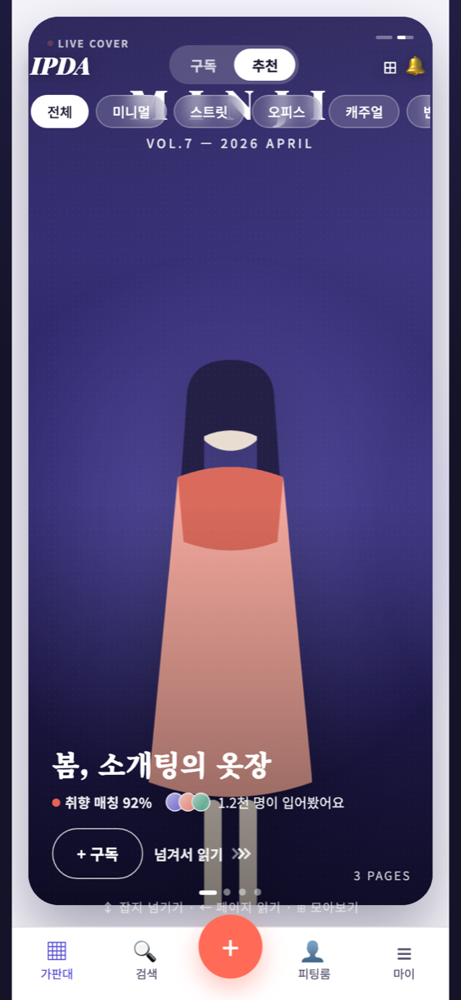
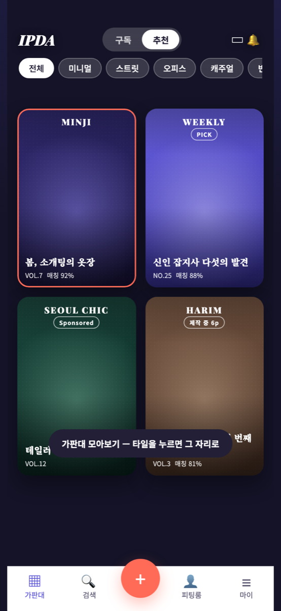
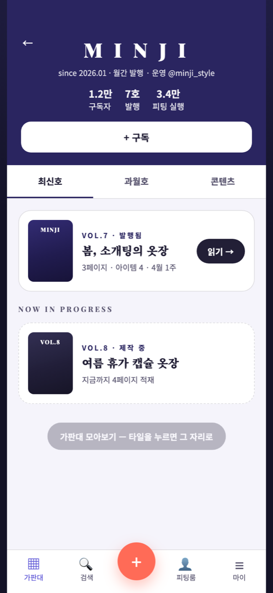
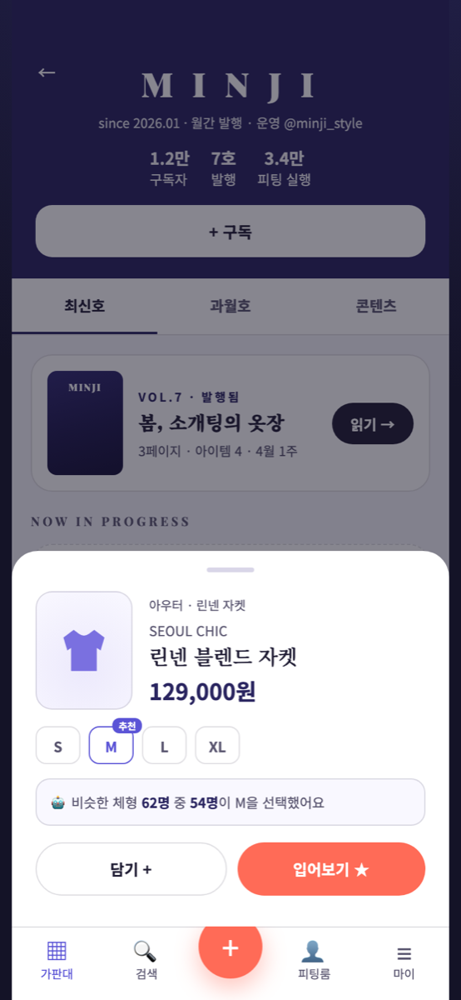
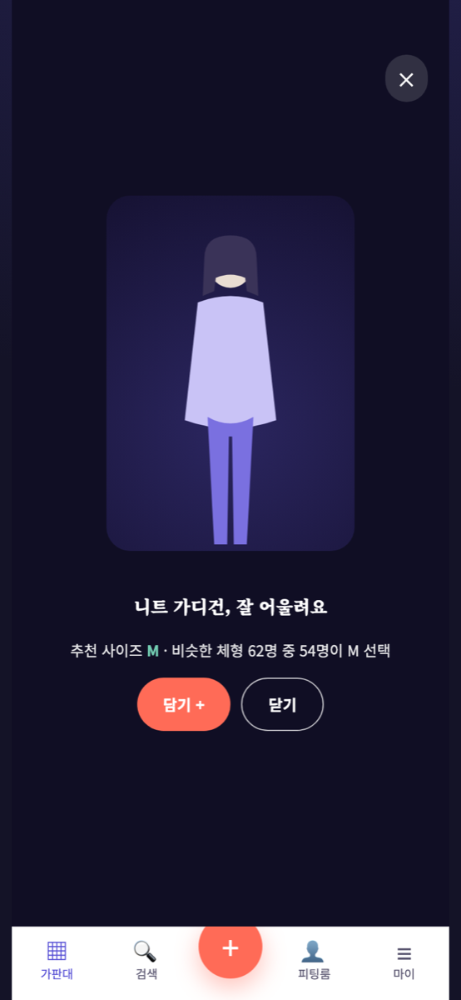
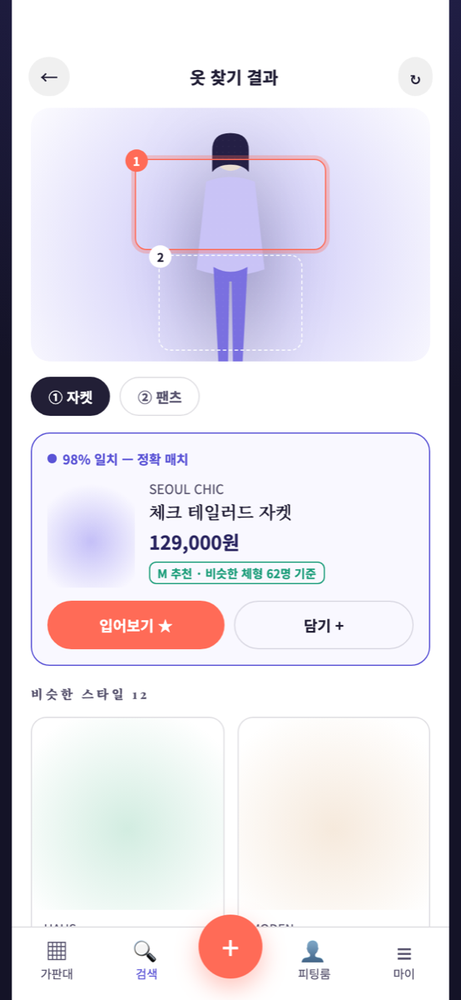

# 👗 IPDA (입다) — 입어보는 패션 잡지

> **See it → Try it → Get it**
> 인플루언서가 발행하는 패션 매거진을 넘겨 보다가, 마음에 드는 옷을 **AI로 내 몸에 바로 입혀 보고** 구매까지 이어지는 모바일 웹 서비스.

이 저장소는 화면과 역할을 소개하는 **쇼케이스**입니다. 서비스 코드와 세부 알고리즘은 비공개입니다.

---

## 화면

<table>
  <tr>
    <td align="center"> <b>가판대</b> 인플루언서 매거진 표지를 넘겨 보는 메인 피드</td>
    <td align="center"> <b>가판대 모아보기</b> 구독·추천 매거진을 한눈에</td>
    <td align="center"> <b>매거진 서가</b> 최신호·과월호·콘텐츠, 구독</td>
  </tr>
  <tr>
    <td align="center"> <b>아이템 상세</b> 내 체형 기준 추천 사이즈 표시</td>
    <td align="center"> <b>AI 피팅 결과</b> 선택한 옷을 내 사진에 입혀 보기</td>
    <td align="center"> <b>옷 찾기 (렌즈)</b> 사진 속 옷을 인식해 비슷한 상품 연결</td>
  </tr>
</table>

화면은 인터랙티브 프로토타입(v0.3)에서 캡처했습니다. 브랜드·인물·상품은 모두 예시입니다.

## 핵심 경험

1. **매거진처럼 읽는 피드**: 상품 목록 대신, 인플루언서가 호(號) 단위로 발행하는 잡지를 넘겨 봅니다.
2. **바로 입어 보기**: 마음에 드는 옷을 누르면 AI가 내 전신 사진에 입혀 줍니다.
3. **사이즈 고민 줄이기**: 비슷한 체형의 사용자 데이터를 바탕으로 사이즈를 추천합니다.
4. **사진으로 옷 찾기**: 길거리·SNS 사진 속 옷을 부위별로 인식해 비슷한 상품을 찾아 줍니다.
5. **내가 만드는 잡지**: 사용자도 자기 코디로 매거진을 발행할 수 있습니다.

## 맡은 역할

1인으로 서비스 전체를 맡았습니다.

- **서비스 기획**: 콘셉트, 타깃(20~35세 패션 관심층), 수익 모델(멤버십 구독 + 커머스 수수료) 설계
- **UX/UI 설계**: 통합 화면기획서·와이어프레임 작성, 인터랙티브 HTML 프로토타입 제작(v0.2 → v0.3)
- **아키텍처 설계·개발 착수**: 모노레포 구성, API·DB 스키마, AI 피팅 파이프라인과 실시간 진행률(WebSocket) 설계
- **AI 에이전트 팀 운영**: Claude Code에 역할별 에이전트(테크 리드·디자이너·프론트·백엔드·AI 연동·보안·DevOps)를 정의하고, 기능마다 설계 → 구현 → 보안 리뷰 → 배포 흐름으로 개발

## 설계한 기술 스택

| 영역 | 기술 |
|---|---|
| 프론트엔드 | Next.js 14 (App Router), TypeScript, Tailwind CSS, shadcn/ui, Zustand, TanStack Query |
| 백엔드 | Node.js + Express, Prisma, Supabase (Auth · PostgreSQL) |
| AI 피팅 | 이미지 생성 API + Claude Vision 품질 채점, BullMQ 작업 큐, WebSocket 진행률 |
| 인프라 | Redis(Upstash), AWS S3 + CloudFront, Vercel(web) + Railway(api), Sentry |
| 결제 | PortOne v2 |
| 구조 | pnpm + Turborepo 모노레포 (web · api · shared 타입/스키마) |

## 진행 상태

- ✅ 서비스 기획, 화면기획서, 인터랙티브 프로토타입
- ✅ 모노레포·API 골격·공유 타입/스키마 셋업
- ⏳ AI 피팅 파이프라인, 결제, 피드 개인화 구현

---

© 2026 John Yang. All rights reserved.
